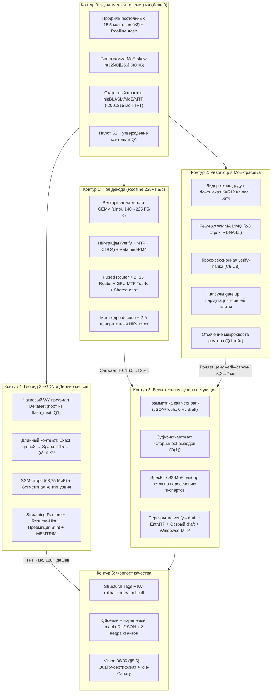

# ROADMAP_SPEC_NEXT_02: Архитектура уникального inference-движка `gufo-faex2` на Strix Halo `gfx1151`

**Назначение документа.** Единая непротиворечивая архитектурная спецификация следующего поколения `gufo-faex2`, сведённая из проектных проработок и выверенная напрямую по исходному коду C++/HIP и фактическим замерам продакшена (`b81812aa`). Исполняемый пошаговый порядок работ, проверок гипотез и приёмки вынесен в парный документ — [MASTER_PLAN_02.md](MASTER_PLAN_02.md).

**Целевая платформа и модель:** AMD Strix Halo (`gfx1151`, 128 ГБ LPDDR5X UMA), **Qwen3.6-35B-A3B** (40 слоёв: **30 Gated DeltaNet** + **10 Gated Attention** `16 Q / 2 KV`, `hidden = 2048`; MoE `256` роутируемых экспертов, активны `8 + 1 gated shared`, `expert_ff = 512`; веса `UD-Q4_K_XL`, встроенная MTP-голова, `mmproj-BF16`). Главная нагрузка — **Hermes Agent** (русский язык, 20+ tool-схем, длинный префикс `~13K` и истории `24K–64K`, зрение, 1–4+ параллельных диалога) и **OpenCode 2.3.0** (код).

> **Статус документа.** Это мастер-архитектура и единый план эволюции движка. Документ сам по себе не запускает сборки, GPU-прогоны и изменения продакшена — каждый этап открывается по решению владельца и доказывается измерениями.

---

## 1. Формула уникальности: почему такого движка нет ни у кого

Почти все открытые движки (`llama.cpp`, `vLLM`, `SGLang`, `TensorRT-LLM`) строятся вокруг одного шаблона: *«чистый трансформер на дискретной NVIDIA с батчингом прозы»*. На iGPU/UMA Strix Halo с гибридной MoE-моделью этот шаблон оставляет на столе **в 2–3 раза больше скорости и качества**, чем принято считать возможным.

Наш финальный движок бьёт всех не одной «фишкой», а **синергией четырёх систем, которых нет вместе ни в одном открытом решении**:

1. **Roofline-декод под UMA `gfx1151`:** снятие 9 % пузыря запусков (586 запусков/токен → бакетные HIP-графы + fusion + персистентные участки), выход GEMV и few-row WMMA MMQ на физический потолок LPDDR5X (~220–240 ГБ/с) и полная дедупликация чтения экспертов MoE.
2. **Беспотерьная супер-спекуляция (`Zero-Loss Super-Speculation`):** три согласованных источника черновиков — **автомат JSON-грамматики**, **суффиксный автомат по истории и tool-результатам** (`suffix_automaton.hpp` уже есть в репозитории!) и **MoE-осознанная MTP-голова (SpecFit / S2-MoE)** под управлением мгновенного энтропийного планировщика **EntMTP** и перекрытия `verify → draft`. Всё математически **lossless** по теореме rejection sampling.
3. **Гибрид 30-GDN / 10-Attn как первоклассное «Дерево сессий»:** использование того, что **75 % слоёв модели имеют константное состояние 63,75 МиБ** (в 40 раз меньше KV на 128K!). Чанковый WY-префилл DeltaNet, per-block SSM-якоря, сегментная континуация (cache-editing без сброса префикса), `resume_hint`, потоковое восстановление с диска и продуктивная преемпция (Stint) превращают **TTFT второго хода в единицы миллисекунд как контракт**.
4. **Наступательное качество (выше `llama.cpp` на тех же весах):** структурные теги + мгновенный KV-rollback при невалидном tool-call (0 сломанных вызовов инструментов без «удушения» рассуждений), `Q6dense` / expert-wise `imatrix` под кириллицу и tool-JSON, `36/36` vision и автоматический **паспорт качества (`quality-certificate.json`)** на каждую сборку.

---

## 2. Физика железа: точный байтовый бюджет одного токена на `gfx1151`

Чтобы не гадать и не складывать проценты «на глаз», зафиксируем **точную физику одного шага генерации** `Qwen3.6-35B-A3B` на Strix Halo (`gfx1151`, LPDDR5X UMA). Все числа выверены по коду `src/models/qwen/` и замерам `DECODE_DEPTH.md` / `OPTIMIZATION_BACKLOG.md`:

* **Потолок памяти (LPDDR5X UMA, ECO 100 Вт):** аппаратный потолок **~240–256 ГБ/с**. Лучшие наши ядра уже добираются до **199 ГБ/с** (`attention group8 wave64`) и **227 ГБ/с** (`MTP lm_head`). Большие GEMV разбросаны в диапазоне **140–225 ГБ/с**. Эффективная пропускная способность полного шага plain decode сегодня — лишь **~95–105 ГБ/с** (60,6 ток/с).
* **Текущая экономика шага (измерено):**
  * Plain AR-шаг: **$T_0 \approx 15,5\text{–}16,5\text{ мс}$** (`586` запусков ядер/токен, **~9 % = ~1,5 мс** чистого простоя GPU между запусками).
  * MTP1-шаг (2 строки верификации + проход головы): **~21,9 мс** при принятии **83–93 %** (`tool` 91,8 %, `prose` 74–83 %) → **85–87 ток/с** на Hermes (`111` код, `122` JSON, `72` проза).
  * **Закон стоимости строки верификации:** и MTP1 (`21,9 мс` при 2 строках), и закрытый DFlash2 (`53,4 мс` при 8 строках) ложатся на одну линейную формулу:
    $$T_{\text{step}}(R) \approx 16,5\text{ мс} + 5,3\text{ мс} \times (R - 1)$$
    где $R$ — число строк верификации, а **$c_{\text{row}} \approx 5,3\text{ мс}$** — маржинальная цена одной дополнительной строки сегодня!

### Куда уходят байты и миллисекунды на 1 токен (C1, AR vs MTP1)

| Компонент шага | Объём трафика на 1 токен (C1) | Доля постоянной базы | Время при идеале 230 ГБ/с | Главный рычаг оптимизации |
|---|---|---|---|---|
| **MoE роутируемые (8 × 40 слоёв):** `gate` Q4_K (0,59 МБ) + `up` Q4_K (0,59 МБ) + **`down` Q6_K (0,86 МБ)** | **~653 МБ** *(из них `down` = 275 МБ = **42 %**!)* | **~40 %** | ~2,84 мс | Лидер-якорь `down` (C2–C8/MTP), few-row WMMA, капсулы `gate\|up`, отсечение микрохвоста (Q1) |
| **Выходная голова `lm_head`** (248 320 × 2048, ~4,5 бит) | **~286 МБ** | **~17 %** | ~1,24 мс | Векторизация `uint4` GEMV-хвоста |
| **Плотные проекции** (`QKV`, `attn_out`, `ssm_in/out`, `shared_expert` ~69 МБ × 40 слоёв) | **~450–550 МБ** | **~30 %** | ~2,15 мс | Векторизация GEMV + слияние/поток `shared_expert` |
| **Роутер MoE (`ffn_gate_inp`)** (40 × 256 × 2048 × FP32) | **80 МБ** | **~5 %** | ~0,35 мс | Рекод в **BF16 при загрузке (−40 МБ!)** + Fused Router |
| **Активное состояние DeltaNet (30 слоёв × 2 МиБ, чтение+запись)** | **120 МБ** *(константа!)* | **~7 %** | ~0,52 мс *(~0,6 мс факт)* | **Держать в FP32!** (Амортизируется на весь батч verify — при $T=8$ всего 15 МБ/токен!) |
| **Итого постоянная база (короткий контекст)** | **~1,60–1,69 ГБ** | **100 %** | **~7,1–7,3 мс (физ. предел)** | **Реалистичная цель с графами и GEMV: 11,5–12,5 мс (80–87 ток/с plain!)** |
| **Растущий KV-кэш (10 слоёв Attn, FP16)** | **+20,48 МБ / 1K токенов** *(1,31 ГБ на 64K; 2,62 ГБ на 128K)* | +6,6 мс @ 64K; +13,2 мс @ 128K | ~5,7 мс @ 64K | Exact group8 → 225+ ГБ/с → **Sparse T15** → **Q8_0 KV** (−47 % трафика) |
| **Обвязка MTP1 (черновая голова 161K + CPU top-k + 2-я строка)** | +~320–508 МБ + 644 КБ download | **+5,3 мс/строку** | ~1,8–2,5 мс (цель!) | **GPU MTP Top-K**, **HIP-графы**, **Windowed-MTP**, **SpecFit**, **Грамматика/Suffix (0 мс draft!)** |

> **Главный инженерный вывод таблицы (простыми словами):**
> 1. На короткой истории доминируют **веса MoE + GEMV + пузырь из 586 запусков**.
> 2. Уже с **~5 900 токенов** чтение KV-кэша (10 слоёв) обгоняет трафик всех 30 слоёв DeltaNet, а на 64K–128K становится главным тормозом.
> 3. **Почему проваливаются «глубокие» деревья и MTP2/3 на C2–C4?** Потому что маржинальная строка верификации стоит **5,3 мс** (дублирующиеся чтения `down_exps` + несовпадающие эксперты + отсутствие графов). Как только мы уроним $c_{\text{row}}$ с 5,3 до **~2,0–2,5 мс**, спекуляция глубины 2–4 и деревья станут **взрывным ускорителем**, а не тормозом!

---

## 3. Аудит гипотез: разрешённые противоречия и вычищенные мифы

В ходе предварительного анализа ряд гипотез противоречил друг другу либо опирался на неверные предположения о коде и железе. Вся архитектура `ROADMAP_SPEC_NEXT_02` очищена от этих расхождений прямыми проверками исходников:

| # | Противоречие или ошибка в ранних гипотезах | Факт из кода / физики | Итоговое решение в спецификации |
|---|---|---|---|
| **1** | Гипотеза «Т18»: утверждалось, что `continuation_adapter.cpp:330-341` уже возвращает префикс аргументов tool-вызова без прогона модели. | Прямая проверка [`src/models/qwen38_flash_next/continuation_adapter.cpp`](../../src/models/qwen38_flash_next/continuation_adapter.cpp#L316-L360): это метод `BeginRestore` для границ компонентов Flash-Next. Такой фичи в проде нет. | **Миф удалён.** Задача ускорения tool-аргументов решается реально — через **Грамматику-как-черновик** и готовый `suffix_automaton.hpp` (Контур 3). |
| **2** | Завышенный потолок памяти: в части оценок фигурировали `620 vs 720 ГБ/с`. | На Strix Halo `gfx1151` LPDDR5X физический потолок **~240–256 ГБ/с** (измерено `199–227 ГБ/с` в лучших ядрах). `620–720 ГБ/с` — ошибка от дискретных GPU. | **Исправлено.** Все расчёты переведены на реальный потолок **240 ГБ/с**. |
| **3** | Предложение переносить с нуля из `pwilkin/llama.cpp` «тайлированный GDN (регистры + DPP)» и `no-mmap` загрузчик. | Проверка кода: [`src/models/qwen/hip/kernels/ssm_row_split.hip`](../../src/models/qwen/hip/kernels/ssm_row_split.hip#L130-L204) **уже** держит состояние в регистрах (`s_reg`) и использует `XorAddDpp`; [`src/core/hip/weight_upload.cpp`](../../src/core/hip/weight_upload.cpp#L201-L205) **уже** грузит веса через `O_DIRECT` + `pread` прямо в память GPU (Пакет C). | **Не изобретаем заново.** Для ускорения GDN-префилла берём реальный неиспользованный клад внутри нашего репо — **Чанковый WY-префилл** из [`kernels.hip.cpp:9249`](../../src/models/qwen38_flash_next/kernels/rocm/kernels.hip.cpp#L9249-L9272). |
| **4** | **Деревья верификации (`EntMTP` / top-2)** vs расчёт проигрыша ($13,9$ vs $11,8\text{ мс/токен}$). | Оба правы в своих точках! При текущей $c_{\text{row}} = 5,3\text{ мс}$ и принятии 85,7 % дерево проигрывает. Точка окупаемости дерева — **$c_{\text{row}} < 2,0\text{–}2,5\text{ мс}$**. | **Строгая фазовая зависимость:** сначала Контуры 1–2 + **SpecFit** обрушивают $c_{\text{row}}$ до ~2 мс; только после этого включается **EntMTP** (цепочка / узкое дерево по энтропии). |
| **5** | **Точность DeltaNet-состояния:** перевод активного состояния из FP32 в FP16/BF16 (с ошибочной оценкой трафика «1,6 ГБ каждый шаг») vs требование **строго FP32** (`ReplaySSM`). | 1,6 ГБ — это *общий бюджет памяти* 4 сессий с банками отката; активный трафик на 1 сессию всего **120 МиБ/шаг (~0,6 мс, ~3 % шага)**. В `ReplaySSM` FP8-состояния обрушили GPQA на **−31 пункт**. | **FP32 остаётся стандартом активного состояния** (0 риска дрейфа на 30 слоях). **FP8 запрещён.** Сжатие (BF16 / STEPQuant 6-bit / DASC) применяется к **чекпоинтам/снапшотам**, а в активном слое — лишь если `rocprofv3` на C4 покажет >5 % вклада и пройдёт `Q1`. |
| **6** | **Длинный контекст:** `GUFO_QWEN_SPARSE_ATTN=1` vs жёсткое скользящее окно KV vs `Q8_0` KV (несовместим с текущим sparse-ядром). | Жёсткое отбрасывание головы KV — высокий OOD-риск для поиска фактов («иголок») в 10 attention-слоях. А вот окно **только для MTP-головы** (`Windowed-MTP`) абсолютно lossless! | **Чёткая лестница:** (0) **Windowed-MTP** + точный group8 → 225+ ГБ/с (100 % lossless) → (1) **`GUFO_QWEN_SPARSE_ATTN=1`** (выбор важных блоков, `Q1`) → (2) **`Q8_0` KV** (с поканальной шкалой K и хвостом `<32`, `Q1`). Жёсткое окно KV **отклонено** для 32K–128K. |
| **7** | **Наивное перемножение процентов:** «×1,10 × 1,25 × 2 ≈ ×2,7 везде» без учёта закона Амдала и полосы памяти. | Ускорения внутри одной фазы не перемножаются линейно (если вы убрали 10 % пузыря, доля GEMV выросла, а потолок 240 ГБ/с не сдвинулся). Зато ускорение *шага* ($T_0$) и рост *принятых токенов за шаг* ($E[\text{tok/step}]$) действительно **мультипликативны**! | Все целевые числа в §11 пересчитаны через **двухфакторную физическую модель**: $\text{tok/s} = \frac{E[\text{tok/step}]}{T_0 + (R-1)\cdot c_{\text{row}} + T_{\text{KV}}}$. |

---

## 4. Контур 0: «День нуля» — Измерения, телеметрия и бесплатные победы

Никаких догадок вслепую: эти 5 шагов за 1–2 сессии убирают все «белые пятна» и дают немедленный профит в TTFT.

1. **Полная разборка постоянных 15,5 мс (`rocprofv3` + per-kernel Roofline T11):**
   * *Проблема:* в `DECODE_DEPTH.md` разложено только внимание, а 15,5 мс постоянной части лежат одной строкой «всё остальное». Неизвестно, какие именно GEMV-ядра ползут на 140 ГБ/с, а какие уже у потолка 225 ГБ/с; неизвестна точная пауза `verify → draft` и доля SSM-ядер в prefill.
   * *Инструменты:* `tools/prof/prof.py`, `tools/bench/gfx1151_peak.hip`, `tools/bench/asr_decode_gemv_bench.hip`.
   * *Выход:* точная таблица «ядро → мс/шаг → ГБ/с → зазор до 240 ГБ/с» для C1, C4, MTP1, MTP2/3 и prefill 16K.
2. **Телеметрия MoE-skew (`int32[40][256]` device-гистограмма, 40 КБ, graph-safe):**
   * *Механизм:* 8 атомарных инкрементов в `MoeRouterTopKKernel` (`src/models/qwen/hip/kernels/moe.hip`) + буфер маршрута прошлого токена (`prev_ids`). Один offload 40 КБ в конце запроса. **Побитово нейтрально.**
   * *Что решает:* закрывает неизмеренную гипотезу просадки `MTP2/3` (−5…−33 %), измеряет реальный индекс Джини роутера (у `llama.cpp` ~0,76), пересечение экспертов между сессиями и между `top-1`/`top-2` (ключ для SpecFit и дедупликации `down_exps`), и массу 7–8-го эксперта (ключ для отсечения хвоста).
3. **Стартовый прогрев конвейера до первого HTTP-запроса:**
   * *Механизм:* `WarmMoeDecode` (`src/models/qwen/hip/moe_ffn.cpp:73-94`) уже написан, но вызывается только перед графом. Вынести в инициализацию `serve llm`: 1 холостой шаг AR(`T=1`), verify(`T=2`), MTP-шаг и прогрев планов `hipBLASLt` для штатных форм prefill.
   * *Эффект:* мгновенно снимает измеренные **−200…315 мс** с первого TTFT после старта (ленивая загрузка 3,6 МиБ ELF `hipBLASLt`) и убирает всплески 27–39 мс на C4. **Побитово нейтрально.**
4. **Сверка энергопрофиля (ECO 100 Вт vs TDP-потолок):**
   * *Механизм:* один контрольный прогон `gfx1151_peak` и `model-bench.py` с фиксацией реального лимита TDP. Если compute-bound prefill или часть GEMV упираются в 100 Вт, владелец получает точную цену вопроса «ватты ↔ +5–15 % prefill» (без самовольных изменений ОС).
5. **Живой пилот Б2 + утверждение открытых полей `Q1`:**
   * Инструментарий (`faex2_appset` 96 задач + `logits-nll-report.py --mode q1`) уже готов на CPU. Утверждение порогов владельцем открывает зелёный коридор для быстрой и честной приёмки всех не-побитовых ускорений (Sparse T15, WY-prefill, Q8_0 KV, BF16 Router, Q6dense).

---

## 5. Контур 1: «Пол скорости декода» — Снимаем пузырь запусков и бьём в 225+ ГБ/с

Цель контура — сжать постоянную базу шага **$T_0$ с 16,5 мс до ~11,5–12,5 мс** (подняв даже чистый AR-decode до **78–87 ток/с**) и вычистить все host-задержки внутри цикла токена.

### 1.1. Векторизация «хвоста» деинтквантованных GEMV (140 → 225 ГБ/с)
* *Простыми словами:* сейчас часть больших матричных умножений читает сжатые веса из памяти «по одному байту за раз» (`wblk0.qs[i]` в `src/models/qwen/hip/kernels/gemv_quant.hip:73-75`), из-за чего контроллер LPDDR5X простаивает.
* *Решение:* перейти на 16-байтовые векторные загрузки (`uint4`), распаковку кодов в регистрах, 2–4 независимые цепочки накопления и перенастройку `__launch_bounds__` под 40 CU `gfx1151` — **строго сохраняя порядок суммирования** в `QuantWarpBlockDot`. Прецедент в том же файле («строка на волну» для Q4_K `ssm_out`) уже дал **−28 %** времени ядра!
* *Эффект и качество:* **+5–12 % decode** (зависит от карты Контура 0), **100 % побитово**.

### 1.2. Бакетные HIP-графы + Retained-PM4 + Event-less очереди (убийца 9 % пузыря)
* *Проблема:* сейчас `HipGraphDecodeExecutor` работает только для одиночного AR (`T=1`) и отключается при `split-K` и на всех путях `MTP1` (`ForwardVerificationBatch`, `ForwardTokenBatch`, `QwenMtpGpuExecutor::Run`). На токен уходит **586 отдельных запусков ядер** → ~9 % чистого простоя GPU.
* *Решение (3 ступени):*
  1. **Бакетный пул `hipGraphExec_t` (T3–T5b):** пул графов под длины верификации и C1/C4, передача позиции через device-указатель (`d_decode_step_params`) в обоих split-K ядрах (`attention_decode_verify_wave64.hip`, порог `512`, и `attention_decode.hip`), захват `ForwardVerificationBatch` + `QwenMtpGpuExecutor`, обязательная инвалидация при `TrimRollback` (урок `Q6dense`).
  2. **Event-less record-queue на ветвлениях:** там, где граф рвётся о динамические условия (маски грамматики, ветвление верификатора), использовать плотную очередь без лишних `hipEvent` синхронизаций.
  3. **Спайк Retained-PM4 (`pwilkin/rocm-systems`):** замерить, сколько микросекунд ROCr тратит на перекодирование PM4-пакетов графа на каждый replay; если заметно — использовать `hsa_ven_amd_graph_command_list_create/_materialize_packet` для нулевой цены повторного запуска!
* *Эффект и качество:* **+6–10 % decode** (на C2–C4 ещё выше), **100 % побитово**.

### 1.3. Слияние запусков и перенос черновой выборки на GPU
* **Черновые строки MTP на GPU (`LaunchMtpRowTopK`):**
  * *Проблема:* в боевом sampled-профиле Hermes (`temp > 0`) **на каждом шаге** `ChooseDraftToken` скачивает с GPU 161 074 float (**644 КБ**) и крутит CPU-поиск top-32 (`MtpTopKDistribution`), блокируя конвейер! Для цели выборка уже на GPU (`LaunchGPUSpeculativeSampling`), а для черновика — нет.
  * *Решение:* ядро `LaunchMtpRowTopK` (плиточный max + сегментный top-32 с тем же tie-break «меньший id раньше») возвращает на CPU всего **~400 байт** (32 id + 32 prob + выбранный токен).
  * *Эффект:* **+1–4 % на 100 % боевого sampled-трафика**, побитово к оракулу `sampled_mtp_chain_test`.
* **Fused Router (`logits + softmax + top-k` одним блоком):**
  * *Механизм:* один блок на строку считает `256 + 1` скалярных произведений (`RouterRowDot`), держит 256 float (1 КиБ) в LDS и тут же делает softmax + top-8. Убирает **−40 запусков/токен** и 80 КиБ лишнего трафика/слой. **Побитово** (+0,5–1,5 %).
* **Роутер `ffn_gate_inp` в BF16 при загрузке:**
  * *Механизм:* проверить тип тензора в текущем GGUF; если FP32 — перекодировать в BF16 при загрузке (движок уже поддерживает `kBF16` в `state.hpp:27`, `ROADMAP §3.1` явно разрешает, логиты всё равно считаются в FP32). Снимает **−40 МБ/токен** (**+1,3–2,5 % decode** + ускоряет prefill). Контроль: KL ≤ $2\cdot10^{-5}$ + 9/9 argmax + `Q1`.
* **Shared-эксперт (−160 запусков/токен или 2-й поток):**
  * *Механизм:* сейчас shared-эксперт делает 4 отдельных запуска на слой (160 запусков/токен из 586!). Если в GGUF `shared_expert_ff == expert_ff == 512` и типы совместимы → **Вариант А:** дописать shared как «слот №256» с весом `sigmoid(shared_logit)` прямо внутрь grouped MoE (**7 запусков → 3 на слой, −27 % всех запусков движка!** +2–4 %, проверка через KL/Q1). Если геометрии/типы расходятся → **Вариант Б:** гнать shared в параллельном HIP-потоке с event перед combine (**побитово**, +1–3 %).
* **Zero-copy GPU-скачки между стадиями:** убрать любые промежуточные пересылки `верификатор → роудер → MoE` через host — данные уже лежат в L2/UMA.

### 1.4. Высший эшелон (после графов): Персистентное Мега-ядро + Двухпоточный GPU-планировщик
* **Персистентное мега-ядро decode (ступень над графами):** одно персистентное ядро, удерживающее исполнение на 40 CU без возврата к командному процессору между операторами внутри слоя/стека. Строится *после* HIP-графов и снятия нового профиля (Т10), чтобы добить остаточный зазор до аппаратного потолка LPDDR5X на UMA.
* **Второй приоритетный HIP-поток (продажа пузыря в C2–C4):** decode-шаги идут в высокоприоритетном потоке (`hipStreamCreateWithPriority`), а `StepPrefill`-чанки очередников и `Restore` — в фоновом (не более 1 чанка в полёте, с контролем полосы). Все per-stream буферы уже изолированы (`d891354f`). **Побитово**, ускоряет сумму C2–C4 и режет TTFT очередников.

---

## 6. Контур 2: «Революция MoE-трафика» — Убиваем лишние байты весов и просадку `MTP2/3`

MoE-эксперты съедают **~653 МБ на один токен** (причём `down_exps` в `Q6_K` — **42 %** этого объёма!), а в батче C4 или при `MTP2/3` сегодня происходит массовое повторное чтение одних и тех же экспертов.

### 2.1. Лидер-якорь дедупликация `down_exps` (`K = 512`) на весь батч
* *Проблема:* `gate`/`up` уже дедуплицируются якорями (`group_moe_slots`), а `down` вызывается на `n * used` слот-строк без дедупликации, потому что в `qfn_mmq.hip.cpp:505-508` условие `by_expert` унаследовано от Flash-Next (`K == 640 && (Q5_1 || Q8_0)`). При 72 розыгрышах (C4 × MTP1) или при `MTP2/3` один и тот же эксперт (0,86 МБ) перечитывается по несколько раз!
* *Решение:* расширить схему **лидер-якорь + маска** на весь пакет `down_exps` (`K = 512`, `Q4_K/Q5_K/Q6_K`, до 512 слотов → ≤ 256 уникальных экспертов): лидер-слот читает веса эксперта **один раз**, остальные строки батча умножаются на те же веса в том же блоке. В отличие от простого «in-kernel grouping» (`Q6dense #25`, который лишь сортировал обращения), якорь **физически убирает повторное чтение байтов**. Порог включения задаётся телеметрией Контура 0 (чтобы не платить за якорь при нулевом пересечении).
* *Эффект и качество:* **−13…−20 % MoE-трафика на C2–C8**, ключ к снятию просадки `MTP2/3` (−5…−33 %), **100 % побитово** (проверяется расширением `moe_rows_test.cpp`).

### 2.2. Few-row WMMA MMQ (16×16×16 int8) для 2–8 строк + тайлы под `expert_ff = 512`
* *Механизм (идея `llama.cpp` PR #32224 / #28552 для RDNA 3.5):* при 2–8 строках (ровно наш **MTP verify** и **C4**) обычные MMQ-тайлы недогружают вычислительные блоки RDNA 3.5. Специализированный few-row WMMA-путь (`16×16×16 int8`) с N-тайлами, кратными фиксированной ширине эксперта (`512`), резко поднимает утилизацию при том же трафике весов.
* *Эффект и качество:* **+10–20 % на verify-батчах и C4** — прямой множитель к спекуляции (роняет маржинальную цену строки $c_{\text{row}}$!). Проверка: `moe_rows_test` + KL/побитовый контроль.

### 2.3. Кросс-сессионная verify-пачка (возвращаем MTP на 6–8 пользователей!)
* *Проблема:* сейчас при 6–8 сессиях MTP принудительно отключается (`kMtpMoeMaxCohort = 4`), потому что `ForwardVerificationBatch` гоняет чанки сессий раздельно и перечитывает ~1,6 ГБ весов на каждую сессию.
* *Решение:* объединить target-строки верификации разных сессий в единый GEMV/MMQ-запуск — активные веса читаются **один раз на все сессии**, а `down_exps` дедуплицируется сквозь сессии (п. 2.1).
* *Эффект и качество:* возврат выигрыша MTP на 6–8 пользователях (**178 → ~200–220+ tok/s суммарно**), **побитово** (`decode_rows_ops_test`).

### 2.4. Перепаковка в памяти при загрузке: «Капсулы экспертов» + «Горячая плита»
* **Капсула `gate|up`:** при загрузке в GPU-память интерливить плитки `[gate row0..1 | up row0..1]` в один непрерывный блок вместо двух далёких тензоров по 143 МБ/слой (урок `Q6dense`: скорость даёт перепаковка в памяти, а не новый дисковый формат!). **0 байт лишней RAM, 100 % побитово**, +1–3 %.
* **Пермутация «горячей плиты» (после гистограммы Контура 0):** если skew-профиль покажет выраженных «горячих» и часто со-активируемых экспертов (как Gini ≈ 0,76 у `llama.cpp`), при загрузке одинаково переставить строки `ffn_{gate,up,down}_exps` и `ffn_gate_inp`, собрав горячих экспертов в компактный диапазон адресов LPDDR5X (с сохранением tie-break по исходному индексу). **100 % побитово**, +2–5 % (при плоском skew — пропускаем без траты времени).

### 2.5. Отсечение микрохвоста роутера (управляемый quality-trade, строго через `Q1`)
* *Механизм:* `MoeRouterTopKKernel` уже ренормализует топ-8, а все ядра (`group_moe_slots`, `mul_mat_vec_q_moe`, `combine`) **уже умеют пропускать неактивный слот** (`id = -1, weight = 0`)! Если телеметрия Контура 0 подтвердит, что 7–8-й эксперты несут < 1 % веса на половине токенов, отсекать хвост сверх кумулятивной массы $1 - \varepsilon$ ($\varepsilon \approx 0,005\text{–}0,01$).
* *Эффект и жёсткий барьер:* переход 8 → ~6,5 активных экспертов срезает **−19 % всех байтов MoE** (**+5–9 % tok/s на C1 MTP1**). Включается **исключительно** при безупречном прохождении полного `Q1` и 96 задач Б2 (особо следить за редкими русскими токенами и JSON!).

---

## 7. Контур 3: «Беспотерьная супер-спекуляция» — ×1,8–×2,5 на агентах без единой потери качества

Главная идея этого контура — перестать считать, что черновик может давать *только* дорогая нейросетевая голова MTP глубины 1. По математической теореме speculative decoding (`VerifySampledToken` + rejection sampling в `speculative_verifier.cpp`), **выходное распределение $p$ остаётся математически точным (lossless) для ЛЮБОГО источника черновиков $q$**!

Мы объединяем **три источника черновиков** и **умный планировщик** в единый композитный `IDraftBackend`:

### 3.1. Источник №1 (0 мс draft-затрат): Грамматика как черновик (`Grammar-as-Draft`)
* *Суть (простыми словами):* сейчас `json_constraint` (наш кэш JSON-грамматик на 64 схемы инструментов) работает как *тормоз* — ждёт, пока модель просчитает логиты, и потом зануляет запрещённые токены. Мы переворачиваем его в *турбину*: в зоне tool-call большая часть токенов (`{"tool": "web_search", "arguments": {"query": "`, скобки, кавычки, ключи, enum-значения) **однозначно задана самим автоматом грамматики**!
* *Механизм:* когда у автомата грамматики есть единственный допустимый переход (или короткая детерминированная цепочка до следующего открытого значения), он выдаёт эти токены **напрямую в верификатор без запуска MTP-головы**, а модель лишь подтверждает их одной пачкой (в паре с MTP на свободных значениях).
* *Эффект и качество:* на tool-вызовах Hermes и структурированном JSON даёт **×1,5–×2,5 к эффективным ток/с**, **100 % lossless** (проверено оракулом rejection sampling и `output_sha256`).

### 3.2. Источник №2 (0 мс draft-затрат): Суффикс-автомат истории и tool-результатов
* *База уже в репо!* В [`src/models/qwen38_flash_next/suffix_automaton.hpp`](../../src/models/qwen38_flash_next/suffix_automaton.hpp#L1-L60) уже лежит чистый MIT-код host-side суффиксного автомата со сложностью $O(1)$ на токен, специально спроектированного как второй источник черновиков!
* *Механизм:* подключить `SuffixAutomaton` к `QwenMtpGpuDraftBackend`, индексируя **сгенерированную историю + tool-результаты промпта** (пути файлов, фрагменты кода, цитаты из поиска) и сериализуя его в persistent-снапшот (переживает перезапуск!).
  * Если найден матч длиной ≥ 3 токенов (и для защиты от ложных цитат из чужой роли 1-й токен подтверждается простым правилом/MTP) → выдаём цепочку глубиной `min(match, 4)` **без запуска MTP-головы** (для sampled — дельта-распределение $q(\text{tok})=1$, что полностью корректно для `VerifySampledToken`!).
  * Принятые токены штатно синхронизируют голову через `AcceptFeedback` / `UpdateTargetHidden`.
  * *Опциональный слой REST:* офлайн-спайк поверх постоянного мини-корпуса паттернов Hermes (если доля совпадений ≥ 5 % на холодных ходах — добавить как резервный источник, иначе закрыть).
* *Эффект и качество:* **+10–15 % на классе `tool` и редактировании кода** (локально до 115–130+ ток/с на цитатах), **100 % lossless**.

### 3.3. Источник №3 (прорыв MoE): SpecFit / S2-MoE — мульти-кандидат по объединению экспертов
* *Проблема:* почему обычный `MTP2/3` или «наивный top-2» проваливаются на 2–4 потоках (−20…−33 %)? Потому что два случайных черновых токена активируют **два разных набора по 8 экспертов**, удваивая чтение весов MoE!
* *Решение (SpecFit arXiv:2610.15417 + S2-MoE arXiv:2608.15018):* стоимость пакета верификации в MoE определяется **размером объединения** активированных экспертов (субмодулярная функция). Выбирая второго кандидата/ветку верификации, планировщик максимизирует не просто $p_{\text{draft}}$, а **пересечение маршрутов MoE** с основным кандидатом (прогноз маршрута доступен почти бесплатно из предыдущего прохода / лёгкого роутера).
* *Эффект и качество:* при перекрытии экспертов ≥ 0,8 верификация второго кандидата почти не добавляет чтения весов → в паре с Контуром 2 (`down_exps` дедуп + few-row WMMA) открывает **+15–25 % decode на 2–4 потоках** там, где сырая глубина 2/3 проигрывала! **100 % lossless** (меняется лишь *что* проверяем, верификатор не трогаем).

### 3.4. Четыре турбо-механизма поверх источников черновиков
1. **Перекрытие `verify → draft` (скрытие CPU-пузыря):** сразу после verify-ядер шага $N$ скрытое состояние (`committed_target_hidden_`) и argmax строки уже лежат на GPU. Если зазор `top1 − top2 > 0,8` (выше документированного MoE-шума `0,09–0,82`), ставим head-pass MTP шага $N+1$ в очередь GPU **до того, как CPU закончит разбор шага $N$**! При редком промахе (сработал reasoning-budget или penalties) — чистый откат через готовый `proposal_checkpoint_`. Выигрыш: **+5–13 %** (побитово!).
2. **Мгновенный контроллер топологии EntMTP + Cost Gate (T7):** заменяем запаздывающее окно `rolling_window = 16` на мгновенные бесплатные сигналы — `head-top1` (из 32 кандидатов GPU) и зазор `top1 − top2` последней проверочной строки цели + текущую когорту `C1..C8`:
   * `head-top1 > 0,93` и зазор цели `> 1,0` (после снижения $c_{\text{row}}$ в Контуре 2) → **цепочка глубины 3** (+15–18 % на `tool`/коде!).
   * Средняя уверенность **И** подтверждённое $c_{\text{row}} < 2,5\text{ мс}$ → **узкое 2-веточное SpecFit-дерево** (пока $c_{\text{row}} > 2,5\text{ мс}$ — дерево строго выключено по расчёту!).
   * Зазор цели близок к near-tie (`< порога` из калибровки) или перегрузка когорты → **`SkipDraft` (шаг AR)**, экономит ~5 мс обвязки на заведомо проигрышных токенах!
3. **«Острый» черновик при `temp > 0` ($t_{\text{draft}} < t_{\text{request}}$):** математически lossless для любого $q$; при высокой калибровке головы сужает расстояние TV$(p, q)$ и поднимает acceptance rate. Цена реализации — ~5 строк в `LaunchMtpRowTopK`; знак эффекта проверяется одним прогоном `SpeculativeStats` + $\chi^2$-тестом.
4. **Windowed-MTP (arXiv:2607.21535):** скользящее окно KV + системный sink **исключительно для KV-кэша MTP-головы** (основная модель остаётся полной!). На 32K–128K полностью обрезает рост собственного внимания MTP-головы при **абсолютно нулевом влиянии на качество ответов** (любая ошибка черновика отсеивается верификатором цели!).
5. **Самоподгонка 161K-словаря MTP:** по телеметрии `/metrics` подстраивать состав сокращённого словаря черновика под реальную частотность токенов семьи/Hermes.

---

## 8. Контур 4: «Гибрид как супероружие» — Чанковый WY-префилл, дешёвый 128K и «Дерево сессий» с TTFT ≈ 0

У `Qwen3.6-35B-A3B` **30 из 40 слоёв — Gated DeltaNet** (постоянное состояние **63,75 МиБ/сеанс**), и лишь **10 слоёв — Attention** (20 480 Б/токен KV). Мы превращаем эту архитектуру в то, что чистые трансформеры физически не способны повторить.

### 4.1. Чанковый WY-префилл 30 слоёв DeltaNet (порт из соседней ветки нашего же репо!)
* *Проблема:* хотя наш `ssm_row_split.hip` уже виртуозно использует регистры и `XorAddDpp`, внутри одного чанка на 4096 токенов он остаётся **последовательным токен за токеном (`token-serial`)** — это единственная оставшаяся последовательная цепь во всём prefill!
* *Решение:* в нашем же репозитории в [`src/models/qwen38_flash_next/kernels/rocm/kernels.hip.cpp`](../../src/models/qwen38_flash_next/kernels/rocm/kernels.hip.cpp#L9249-L9275) **уже реализован Chunked WY-form Gated Delta Rule**! Константы `kGd = 128`, `kGkh = 16`, `kGc = 64` совпадают с нашей моделью; нужно лишь адаптировать `kGh: 48 → 32` (`kGch: 10240 → 8192`) и вынести в `src/models/qwen/hip/kernels/ssm_wy_chunk.hip`.
  * *Как работает (простыми словами):* чанк 4096 токенов режется на 64 мини-чанка по 64 токена; внутри всех 64 мини-чанков матричные произведения ($K K^T$, $Q K^T$, обращение нижнетреугольной матрицы $UT$) считаются **одновременно параллельно на GPU**, а последовательный проход делает всего 64 быстрых матричных шага вместо 4096 скалярных!
  * Decode и verify остаются на побитово-точном `ssm_row_split.hip` / `ssm_recurrence.hip`.
* *Эффект и качество:* многократное ускорение SSM-слоёв → **+5–15 % к общему prefill** (особенно на 16K–64K). Так как WY-форма использует F16-операнды (ошибка ~`6e-4`), проходит строгие ворота **`Q1` + CPU-оракул `ssm_test.cpp`** и проверку инвариантности к размеру чанка.

### 4.2. Эшелонированное ускорение длинного контекста (10 слоёв Attention)
Вместо рискованного жёсткого отрезания головы KV (отклонено!) строим **трёхэшелонную защиту**:
1. **Эшелон 0 (100 % lossless):**
   * **Windowed-MTP** (см. §7.4) — срезает внимание самой MTP-головы на 32K–128K без потери качества.
   * **Дожим точного `attention_decode_verify_wave64` (group8) с 199 к ~225–240 ГБ/с:** только битово-безопасные приёмы без изменения порядка tree-sum (шире векторные загрузки/`__ldg`, раскладка LDS, пролог/эпилог) → **+4–6 % на 64K**.
2. **Эшелон 1 (готово, 0 строк нового кода → через `Q1`):**
   * **`GUFO_QWEN_SPARSE_ATTN=1` (T15):** включается автоматически после порога 290 блоков (18 560 токенов), читая только важные блоки истории. Ориентир **~+26 % decode в MTP1** на длинных диалогах! Приёмка: полный `Q1` + 96 задач Б2 (включая барьер `long-facts 22/24` на начало/середину/конец) → включается **дефолтом без флагов**.
3. **Эшелон 2 (ёмкость + полоса → через `Q1`):**
   * **`Q8_0` KV-кэш:** сокращает 10,00 ГиБ → **5,31 ГиБ** на `4 × 128K` (**−4,69 ГиБ** RAM и почти вдвое меньше трафика чтения KV!). Обязательные инженерные детали из уроков `strixite`/`tubo`/`Q6dense`: **поканальная шкала для K** (−42 % ошибки после RoPE), **точный несжатый хвост `< 32` строк** (инвариантность к размеру чанка), **staging в prefill** (обход 2,7× замедления при распаковке внутри WMMA), fused-запись в эпилоге `QK-norm + RoPE`.
   * *Выход за шаблон:* если оба (Sparse и `Q8_0` KV) пройдут `Q1`, дописать вариант `QwenSparseDecodePartialsKernel` для чтения `Q8_0` KV — тогда мы получим **одновременно** экономию памяти ×2 и скорость sparse! (Если sparse провалит `long-facts`, `Q8_0` KV встаёт как чистая замена.)

### 4.3. Первоклассная экономика гибридного состояния: «Дерево сессий и TTFT ≈ 0 как контракт»
Объединяем лучшие идеи из всех 5 туров в одну стройную подсистему памяти и кэширования:

1. **Per-block / Chunk-aligned SSM-якоря (`SnapshotPurpose::kAnchor`, каждые 4K–8K токенов):**
   * *Почему это чудо гибрида:* сохранить промежуточное состояние всех 30 слоёв DeltaNet стоит всего **63,75 МиБ (0,16–0,6 мс копии на 199 ГБ/с!)** — в 40 раз меньше полного KV! При этом KV-кэш 10 слоёв append-only и уже лежит в арене.
   * *Двойной удар:*
     * **Прерываемый prefill без квадратичного хвоста:** если в C4 длинный 64K-prefill вытеснили, он не стартует заново (32 с), а продолжается с ближайшего якоря (≤ 4 с)!
     * **Хит в любой точке 64K-истории (OpenCode / compaction):** при правке на отметке 90 % контекста движок берёт KV `[0..x]` из толстого снимка, SSM-состояние с ближайшего якоря и дочитывает **только дельту**!
2. **Сегментная континуация (семантика Anthropic `clear_at_least` + `prompt_cache_key`):**
   * Хранение истории как цепочки сегментов (поверх уже работающего `kBranchPoint` для `System+Tools` ≥ 512 токенов): зачистка старых tool-выводов в сегменте $k$ **не инвалидирует** снапшоты $1\dots k-1$; дочитывается $O(\text{дельта})$ вместо $O(\text{весь хвост})$.
   * **Наследование веток (`copy-on-fork`):** при ветвлении семейного чата копируется только свежее GDN-состояние (63,75 МиБ), общие префиксы инструментов лежат **единожды на всех** через межсессионный content-addressed `prefix_index` с refcount; в дисковом снапшоте исключается любое дублирование KV и состояния.
   * Расширить кольцо отката `kSsmReplayCapacity` с `16` до `32–64` позиций, чтобы снять скрытый лимит под широкие черновики (урок vLLM 0.32 / ReplaySSM).
   * *Опциональное расширение для 100+ веток:* **SuffixReplay** (arXiv:2609.33477, SGLang) — редкие якоря + короткий реплей суффикса (сжатие хранения до 0,36–0,51×, проверять через `Q1`).
3. **Потоковый `Restore` + `Resume-Hint` API + Продуктивная преемпция (`Stint`) + `MEMTRIM`:**
   * **Streaming Restore с диска:** убрать чтение многогигабайтного снимка целиком в RAM — читать чанками 8–16 МиБ с двухфазной проверкой контрольной суммы, zero-copy переносом (концепт `snapshot_copy.hip`) и переиспользуемым `HostBuffer`.
   * **Контракт `resume_hint` / `episode_id` в API:** наш клиент (Hermes / OpenCode) сообщает, что получил tool-call и вернётся через 1–3 секунды → планировщик *заранее* поднимает снимок в RAM и прогревает слот → **TTFT второго хода падает до единиц миллисекунд гарантированно**, а не по везению!
   * **Продуктивная преемпция à la Stint (arXiv:2611.20106):** если память/слоты заняты под 4–8 агентами, вместо сброса и recompute (как в vLLM V1) планировщик сбрасывает вытесненный слот в RAM-пул (на UMA — почти нулевая цена копирования!) и возвращает его по возрасту с «защитным ходом» декода → **p99 TPOT −50 %**, нулевой KV-thrashing.
   * **Инкрементальные 2-МиБ KV-клетки (`MEMTRIM`):** выделять KV по мере роста диалога, а не резервировать все 10 ГиБ на старте — закрывает **+4–7,5 ГиБ** разрыва по памяти против `llama.cpp` и освобождает RAM под дерево сессий!
   * **Прозрачный OpenAI/Anthropic cache-контракт:** отдавать `cached_tokens` / `cache_write` в `usage` и явные маркеры TTL/cache breakpoints.

---

## 9. Контур 5: «Форпост качества» — Умнее, чище и надёжнее конкурентов

Скорость без качества — мусор. Но качество в нашем движке — не только «защитный барьер», а **активный рычаг превосходства**:

### 5.1. Структурные теги + мгновенный KV-rollback retry для tool-calls
* *Проблема:* принудительная JSON-маска с первого токена «ломает мышление» модели, а без маски случаются битые вызовы инструментов.
* *Решение:* свободное рассуждение (`<think>...</think>`) идёт без ограничений → при входе в тег аргументов tool-call включается **структурная маска + Грамматика-как-черновик** (§7.1) → если валидатор JSON-схемы всё-таки фиксирует ошибку, движок **откатывает KV и SSM-банки ровно к началу аргументов** (доли миллисекунды на наших готовых банках!) и делает 1 тихий retry под строгой маской.
* *Результат:* **0 невалидных tool-call как класс ошибок**, без деградации свободного текста и рассуждений!

### 5.2. Апгрейд точности весов без потери скорости (3 ступени)
1. **`Q6dense` (`Q6_K` dense + `UD-Q4_K_XL` experts, 0 строк кода, T14):** сравнить готовый рецепт смешанной точности (плотные проекции и shared в `Q6_K`, эксперты остаются 4-битными) на `Q1` и скорости; при необходимости взять точечные MIT-ядра `DenseQ6KVec` / `MtpHiddenKernel`.
2. **Expert-wise `imatrix` перекалибровка `UD-Q4_K_XL` под RU и tool-JSON (0 строк кода в движке!):** собрать оффлайн `imatrix`-статистику из BF16-исходника строго на семейном/Hermes/OpenCode корпусе с учётом активаций **по каждому эксперту отдельно**. Биты не меняются (4,5 бит/вес) → **0 % потери скорости**, но масштаб и смещения откалиброваны ровно под кириллицу, школьные формулы и JSON-схемы!
3. **Два «ведра» квантов по карте «частота × ошибка» (если оффлайн-аудит покажет сильный перекос):** 10–20 % самых горячих и шумных экспертов перепаковать в `Q5_K/Q6_K`, остальные оставить в `Q4_K` (ядра `qfn_mmq` уже type-agnostic; +~1–2 % трафика ради заметного падения KL на русском и JSON).

### 5.3. Vision `36/36` и адаптивное чтение крупного текста
* **Публичная гарантия `36/36`:** по замерам 2026-11-19 (`common_max_logit_delta = 0,5138`, `KL = 0,00196`, near-tie зазор `0,03`) дефекта кэша нет. После квалификации по процедуре §5.6 (строгий тест не ослабляется!) «побитовое продолжение диалога с фото домашки из кэша» становится официальной строкой нашего бенча.
* **Победа над слепотой на крупном шрифте (48–96 pt):** свойство весов/проектора (одинаково плохо и в Gufo, и в `llama.cpp`). На уровне предпроцессора изображений (опциональный режим / multi-scale OCR-проба) — автоматическая детекция крупного шрифта или 2×-downscale-копия, возвращающая читаемость заголовков и плакатов.

### 5.4. Непрерывный паспорт качества и самонастройка в простое
* **`quality-certificate.json` на каждую сборку:** автоматический артефакт с SHA бинарника, SHA весов, версией компилятора/ROCm, таблицей `Q1` по всем 7 ячейкам (`RU/code/math × {short, long} + vision`), вердиктом 96 задач Б2 (0 критических, `only_candidate_wrong ≤ 1`, `long-facts ≥ 22/24`) и matched-pair таймингами (порог 5 % / 3 мс по каждому запросу/фазе без усреднения!).
* **Тихий Idle-Canary (закрывает «час ≠ 24/7»):** в периоды простоя живой сервер прогоняет мини-набор золотых проверок и при любом дрейфе поднимает флаг в `/metrics`.
* **Idle Self-Tuning:** на холостом ходу сервер пересчитывает оптимальную карту перестановки горячих экспертов (для следующего планового рестарта) и словарь 161K MTP-головы — **0 мс к латентности запросов**, со временем сервер подстраивается под конкретную семью!

---

## 10. Контур 6: Исследовательская лаборатория (R&D с правом на отрицательный результат)

Четыре смелых ставки с высоким риском — держать **строго отдельно** от боевой ветки, проверять короткими спайками:

1. **DeltaNet Re-baseline и Recency Re-priming (уникальная физика рекуррентной памяти):**
   * *Re-baseline:* раз в ~16K сгенерированных токенов в фоне прогнать chunked prefill последних 2–4K токенов от чекпоинта в банк B и атомарно подменить, «отмывая» накопленный decode-дрейф (`0,51–0,82` логита).
   * *Recency re-priming:* расширить replay-лог до 512–1024 позиций (~253 МиБ в BF16) и в idle прогнать только `BatchedDeltaNetRecurrenceKernel` (**0,6 мс**, без MoE и attention!) поверх сохранённых `(k, v)` — контрактивное дельта-правило усиливает затухшую память о начале собственного длинного ответа («self-needle»). Проверять строго на оракуле в банке B из-за риска двойного затухания!
2. **Training-free Self-Draft MoE (`DraftExpert` / `SpecMoE`) и далёкий горизонт `EAGLE-4`:**
   * Дешёвый спайк: сравнить бесплатный self-draft «shared + top-1 expert» против встроенного MTP1 на прозе.
   * Дальний горизонт: дообученная draft-голова класса `EAGLE-4` (4,7 принятых токена/проверка, day-0 поддержка AMD ROCm) — крупнейший известный потолок спекуляции, но требует отдельного цикла обучения головы.
3. **Steering-векторы (`Representation Engineering`):** прибавление `h += α·v` на 2–3 слоях для подавления лишней «болтовни» и повышения чёткости tool-вызовов. 0 потерь скорости, высокий риск смещения — 2-дневный спайк с побитовым $\alpha = 0$.
4. **Обход аппаратного зависания NPU MC28 (СТРОГИЙ КАРАНТИН):** попытка убрать триггер зависания Data Fabric (всегда-активный NPU без runtime-PM suspend/resume + watchdog GPU + graceful degrade). Потолок выигрыша скромный (+1…9,5 % prefill), риск зависания хоста до power cycle — **только изолированный стенд, никогда не смешивать с продом**, пока AMD не выпустит фикс микрокода/ядра.

---

## 11. Целевое табло производительности `gufo-faex2` (честная физика, без сказок)

Сравнение текущей боевой сборки `b81812aa` и целевого движка `gufo-faex2` (по итогам реализации `ROADMAP_SPEC_NEXT_02`) на тех же весах `UD-Q4_K_XL` (Strix Halo `gfx1151`, 128 ГБ UMA), с разложением по двум независимым осям: **ускорение шага** и **рост принятых токенов за шаг**:

| Дисциплина (то, что реально чувствует семья и агент) | Сегодня (`b81812aa`) | Цель `gufo-faex2` (Next-02) | За счёт каких контуров | Класс доказательства |
|---|---|---|---|---|
| **Plain decode (C1, short)** | 60,6 tok/s (`16,5 мс`) | **78–87 tok/s** (`11,5–12,8 мс`) | К1 (GEMV `uint4`, графы, fused/BF16 router, shared) + К2 (капсулы/плита) | Побитово (+ KL для BF16 router) |
| **MTP проза (C1, short / 64K)** | 72 / 53 tok/s | **95–115 / 75–95 tok/s** | К1 + К3 (GPU top-k, перекрытие, Windowed-MTP, EntMTP) + К4 (Sparse T15) | Побитово (short) / `Q1`+Б2 (64K) |
| **Код (C1)** | 111 tok/s | **150–185 tok/s** | К1 + К2 (`down` дедуп, WMMA) + К3 (Suffix + глубина 3 по EntMTP + SpecFit) | **100 % lossless** |
| **Hermes Tool-JSON / цитаты (главный класс!)** | 87–122 tok/s | **160–240+ tok/s** (**×1,8–2,5**) | К1 + К2 + **К3 (Грамматика-как-черновик + Suffix + SpecFit)** | **100 % lossless** (`output_sha256` / $\chi^2$) |
| **4 пользователя суммарно (turn-2, 30K)** | 187,2 tok/s | **260–330+ tok/s** | К1 (графы C4, 2-й поток) + К2 (`down` дедуп, WMMA) + К3 (SpecFit) + К4 (Sparse) | Matched pair + `Q1` |
| **6–8 пользователей суммарно** | 167–178 (MTP off: 187–208) | **210–250+ tok/s (с MTP!)** | К2 (кросс-сессионная verify-пачка) + К3 (SpecFit) + К4 (`Stint`) | Побитово + p99 TPOT |
| **Prefill (4K–64K)** | 2 862–3 066 tok/s | **3 400–3 900+ tok/s** | К1 (GEMV/BF16 router) + **К4 (Чанковый WY-GDN)** + К0 (проверка TDP) | `Q1` + `ssm_test` |
| **TTFT 2-го хода Hermes / после compaction** | 13,35 мс (RAM) / секунды (диск/сброс) | **< 10–30 мс как контракт** (`prefill_tokens = 0` / $O(\Delta)$) | **К4 (SSM-якоря + Сегменты + Streaming Restore + `resume_hint`)** | Инвариант в тестах (`cache`/`long-context`) |
| **Невалидные tool-calls / Vision `36/36`** | Возможны / `35/36` | **0 % битых tool-calls / `36/36` PASS** | **К5 (Structural Tags + KV-rollback + §5.6 + `quality-certificate.json`)** | 96 задач Б2 + OpenCode 2.3.0 |

---

## 12. Единая дорожная карта внедрения (Волны 0 → 5, без единого конфликта зависимостей)

Каждая волна открывает физическую возможность для следующей. **Нарушать порядок нельзя** (например, нельзя включать деревья EntMTP до падения $c_{\text{row}}$ в Волне 2, и нельзя пилить GEMV-хвост до профиля Волны 0).

| Волна | Состав работ | Критерий перехода дальше (Gate) |
|---|---|---|
| **Волна 0: Зрение и быстрая победа** | Профиль `rocprofv3` постоянных 15,5 мс (T11) + гистограмма MoE-skew + стартовый прогрев `WarmMoeDecode`/`hipBLASLt` + сверка TDP + живой пилот Б2 и утверждение `Q1`. | Есть точная карта узких мест и утверждённый `Q1`; первый TTFT упал на 200+ мс. |
| **Волна 1: Низкоуровневый пол и бесплатный prefill/context** | Векторизация `uint4` GEMV-хвоста (140→225 ГБ/с) + `LaunchMtpRowTopK` на GPU + Fused Router + BF16 Router + включение готового **`GUFO_QWEN_SPARSE_ATTN=1`** (через `Q1`) + **Windowed-MTP** + квалификация Vision `36/36`. | Plain decode ~70–75+ tok/s; длинный контекст +26 % с печатью `Q1`; 100 % побитово на lossless-части. |
| **Волна 2: Обрушиваем $c_{\text{row}}$ (5,3 → ~2 мс) и ускоряем Prefill** | Бакетные HIP-графы (`ForwardVerificationBatch` + `QwenMtpGpuExecutor` + C4 + `TrimRollback`) + **Лидер-якорь `down_exps` K=512** + **Few-row WMMA MMQ** + Shared-слот/2-й поток + **Чанковый WY-префилл DeltaNet** (порт из `flash_next`, через `Q1`). | Маржинальная цена verify-строки $c_{\text{row}} \le 2,5\text{ мс}$; просадка `MTP2/3` на C2–C4 снята; prefill +5–15 %. |
| **Волна 3: Взрыв агентской скорости (Супер-спекуляция)** | **Грамматика-как-черновик** + порт **`SuffixAutomaton`** (с сериализацией) + **Structural Tags + KV-rollback retry** + перекрытие `verify → draft` + **SpecFit / S2-MoE** + **EntMTP** + острый draft + кросс-сессионная verify-пачка (C6–C8). | Hermes `tool` 160–240+ tok/s (100 % lossless); 0 битых tool-calls; C4 > 260 tok/s; C6–C8 с MTP! |
| **Волна 4: Дерево сессий, `TTFT ≈ 0` и точность весов** | **SSM-якоря (`kAnchor`)** + прерываемый prefill + **Сегментная континуация** + **Streaming Restore** + `resume_hint` + преемпция **Stint** + `MEMTRIM` + условный **`Q8_0` KV** (по телеметрии) + **`Q6dense` / Expert-wise `imatrix`**. | Повторный ход Hermes < 30 мс как тест-инвариант; память вровень с `llama.cpp`; качество выше `llama.cpp` по Б2/`Q1`. |
| **Волна 5: Автономность, Ре-профиль (Т10) и Мега-ядро** | Полный ре-профиль (Т10) после Волн 1–4 → персистентное мега-ядро на оставшийся зазор + Retained-PM4 + отсечение микрохвоста роутера (если пройдёт `Q1`) + **`quality-certificate.json` + Idle-Canary + Idle Self-Tuning** + опциональные R&D-спайки Контура 6. | Публикация честного эталонного бенча «Агентский эпизод на Strix Halo» с открытыми сырыми логами и печатью `Q1`. |

---

## 13. Честное кладбище: что проверено и окончательно отклонено

Чтобы ни один будущий агент не сжёг GPU-окна на тупики, фиксируем окончательный список **«НЕ ДЕЛАТЬ»**:

1. **`DFlash2` для `Qwen3.6-35B-A3B`:** измерен и закрыт (`-8,8…-16,1 %` против `MTP1` на `tool`, принятие `48–53 %` vs `83–92 %`).
2. **Слитная «норма + квантование» перед MoE (`1b1dfa80`):** измерена, дала `-0,5…-0,7 %` и сломала побитовую сходимость.
3. **Кэш маршрутов MoE «по парам токенов»:** математически неверен (маршрут зависит от скрытого вектора $x$ всего контекста).
4. **Кэш деквантизованных BF16-экспертов на UMA (`llama.cpp #24528`):** анти-оптимизация — на UMA BF16-копия увеличивает трафик памяти против `Q4_K`/`Q6_K`.
5. **FP8-состояния DeltaNet и FP8-активации/LUT на `gfx1151`:** нет аппаратных FP8 тензорных ядер; в `ReplaySSM` FP8-состояния обрушивают GPQA на `−31` пункт.
6. **Жёсткое скользящее окно KV (W=8K/16K) как дефолт для 32K–128K:** разрушает retrieval фактов в 10 attention-слоях; заменено на `Windowed-MTP` + `Sparse T15` + `Q8_0 KV`.
7. **`rocWMMA` для FlashAttention на Strix Halo** (медленнее обычного HIP-пути), **QuaRot/SpinQuant** (неприменимы к готовым GGUF), **тюнинг small-batch GEMM 3–8 строк** (доля 4,6 %, потолок 1,4 %).
8. **Собственный дисковый формат `.ghalo`:** отложен — перепаковка при загрузке в память (`капсулы`, `горячая плита`, `BF16 router`) даёт тот же выигрыш без потери совместимости со стандартным GGUF.
9. **Фантомный «Т18» (`continuation_adapter.cpp:330-341`):** разоблачён как несуществующая в коде фича; заменён реальным Контуром 3.
10. **NPU в продакшене до фикса MC28:** остаётся в карантине Контура 6.
